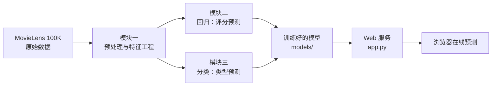

# 🎬 电影评分预测系统

<div align="center">

**基于 MovieLens 100K 数据集的机器学习全流程项目 —— 评分预测 · 类型分类 · Web 在线预测**

   

</div>

## 📖 项目简介

本项目是一个完整的机器学习全流程项目，基于 **MovieLens 100K** 数据集（10 万条评分、943 位用户、1682 部电影），实现两大核心任务：

- **回归任务 —— 电影评分预测**：根据用户画像、电影信息、评分上下文等特征，预测用户对某部电影的评分（1–5 分）
- **分类任务 —— 电影类型预测**：根据电影统计特征，预测电影的「主类型」（17 类）

同时使用 **纯 Python 内置库** 搭建了一个 Web 预测服务，可在线调用训练好的模型进行实时预测。

## ✨ 核心功能

| 模块 | 说明 |
|------|------|
| 📊 数据预处理与特征工程 | 数据探查、四类特征构造（时间/统计/交互/衍生）、编码标准化、数据集划分 |
| 📈 回归：评分预测 | Ridge 岭回归 vs MLP 神经网络，对比 MAE / RMSE / R² |
| 🏷️ 分类：类型预测 | CART 决策树 vs 随机森林（Bagging 集成），对比准确率 / 精确率 / 召回率 / F1 |
| 🌐 Web 在线预测 | 零额外依赖的 HTTP 服务，实时调用模型预测评分与类型 |

## 🛠 技术栈

- **语言**：Python 3.9
- **机器学习**：scikit-learn（Ridge、MLPRegressor、DecisionTree、RandomForest、GridSearchCV）
- **数据处理**：NumPy、Pandas
- **可视化**：Matplotlib、Seaborn
- **Web 服务**：Python 标准库（`http.server`）

## 🔬 特征工程

从原始字段中构造 35 维特征，分为四类：

| 类型 | 特征 | 说明 |
|------|------|------|
| 时间特征 | 评分星期几、是否周末、评分月份 | 从评分时间戳提取 |
| 统计特征 | 用户/电影的平均评分、评分次数、评分标准差 | `groupby` 聚合 |
| 交互特征 | 用户评分均值 × 电影评分均值 | 捕捉用户-电影交互效应 |
| 衍生特征 | 电影被评价时的「年龄」 | 评分年份 − 上映年份 |

## 🏗 系统流程



## 📊 实验结果

### 回归任务（评分预测，测试集 15001 条）

| 模型 | MAE ↓ | RMSE ↓ | R² ↑ |
|------|-------|--------|------|
| Ridge 岭回归 | 0.7333 | 0.9257 | 0.3268 |
| **MLP 神经网络** | **0.7181** | **0.9156** | **0.3414** |

> MLP 结构：输入 35 → 隐藏层 64→32→16 → 输出 1，ReLU + Adam + EarlyStopping，实际迭代 32 轮

### 分类任务（类型预测，测试集 504 条）

| 模型 | 准确率 ↑ | 精确率 ↑ | 召回率 ↑ | F1 ↑ |
|------|---------|---------|---------|------|
| **CART 决策树** | **0.9921** | **0.9923** | **0.9921** | **0.9918** |
| 随机森林（200 棵树） | 0.9901 | 0.9904 | 0.9901 | 0.9897 |

## 🚀 快速开始

### 环境要求

- Python 3.9+
- pip

### 安装与运行

```bash
# 1. 安装依赖
pip install -r requirements.txt

# 2. 数据预处理（首次运行会自动下载 MovieLens 100K 数据集）
python src/module1_preprocessing.py

# 3. 训练所有模型（保存到 models/）
python train_models.py

# 4. 启动 Web 预测服务
python app.py
```

浏览器打开 **http://localhost:5000**，即可体验评分预测与类型分类。

> 也可直接运行 `python src/module2_regression.py` 和 `python src/module3_classification.py` 分别查看回归 / 分类的实验对比与图表。

## 📁 项目结构

```
movie-rating-prediction
├── app.py                     # Web 预测服务（纯标准库，零额外依赖）
├── train_models.py            # 训练并保存所有模型
├── build_presentation.py      # 生成答辩素材（图表 + 输出）
├── requirements.txt
├── src/
│   ├── config.py              # 全局配置（路径、模型参数、随机种子）
│   ├── data_download.py       # MovieLens 100K 下载与模拟数据生成
│   ├── module1_preprocessing.py  # 模块一：数据预处理与特征工程
│   ├── module2_regression.py     # 模块二：回归（Ridge vs MLP）
│   ├── module3_classification.py # 模块三：分类（决策树 vs 随机森林）
│   └── utils.py               # 工具函数（评估指标、图表、数据加载）
├── templates/                 # Web 页面模板
├── static/                    # Web 静态资源（图表）
└── presentation/              # 答辩素材（图表 + 实验输出）
```

## 📝 说明

- 数据集由 `data_download.py` **首次运行时自动下载**（MovieLens 100K，约 5MB），无需手动准备
- 处理后的数据（`data/`）和训练好的模型（`models/`）均可由脚本重新生成，故未纳入版本库
- 实验结果图表见 `presentation/figures/`，实验原始输出见 `presentation/regression_output.txt` 和 `classification_output.txt`
